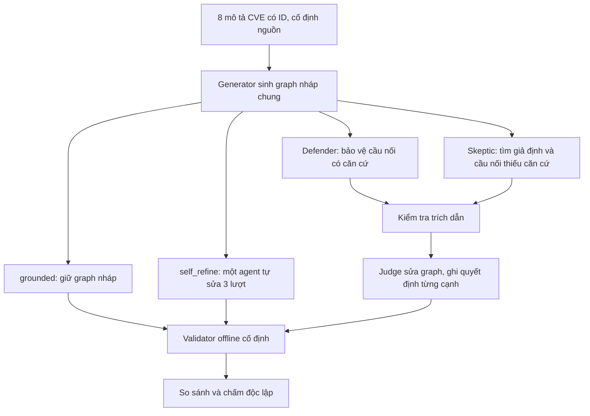

# Cải tiến generation bằng tranh luận có đối chiếu nguồn

Thử nghiệm này đưa phản biện vào **lúc sinh graph**, trước validator hiện có.
Mục tiêu là sửa căn cứ nối cạnh và giữ đúng danh tính CVE. Chưa có kết quả API
hay nhãn chuyên gia chứng minh phương pháp mới tốt hơn.

## Vì sao thử cách này?

Đợt C2 trước có 58 cạnh trong 10 graph. Sau policy, cả ba reviewer đều trả
35 `conditional`, 23 `unknown`, không có thay đổi nhãn được chấp nhận. Trong
23 cạnh unknown, 16 cạnh vướng ánh xạ CVE, 7 cạnh thiếu căn cứ cho cầu nối.
Đó là hai điểm generation cần xử lý. Đổi reviewer hoặc yêu cầu nhiều model
đồng ý không tự tạo thêm bằng chứng về môi trường.

Nguồn kết quả cũ: `outputs/validation_experiments/c2_10_20261016_three_reviewers_01/comparison.json`.

Ý tưởng lấy cảm hứng từ Khan et al.,
[Debating with More Persuasive LLMs Leads to More Truthful Answers, ICML 2024](https://proceedings.mlr.press/v235/khan24a.html).
Bài gốc cho hai bên tranh luận về hai đáp án đối lập, kiểm tra trích dẫn, rồi
để judge chọn đáp án trong bài đọc hiểu. Ở đây ta chuyển sang tranh luận từng
cạnh, judge được xem đầy đủ nguồn, và không tối ưu độ thuyết phục. Đây là
**biến thể thử nghiệm**, không tái lập thiết kế hay kết quả của bài gốc.

## Luồng mới



- **Generator:** một node cho mỗi CVE, ID chính xác, pre/postcondition; không
  ép số cạnh. CVE không nối được vẫn giữ thành node độc lập.
- **Defender:** tìm lý do có căn cứ để giữ cạnh, kể cả cạnh có điều kiện.
- **Skeptic:** tìm prerequisite còn thiếu, sai nền tảng/quyền truy cập, suy
  diễn quá mức. Có thể đồng ý giữ cạnh nếu nguồn đủ căn cứ.
- **Judge/editor:** đọc nguồn cùng tranh luận rồi giữ/sửa/bỏ/thêm cạnh; không
  lấy số phiếu làm chân lý. Mọi thay đổi phải có lý do trong `decisions`.

Hai bên nhận cùng draft và các vòng trước. Prompt vòng hiện tại được tạo
trước khi gọi bên nào, nên không nhìn câu trả lời hiện tại của đối phương.
Mặc định chỉ **1 vòng**, hai bên có cùng giới hạn 80 từ cho phần lý do trên
mỗi cạnh. Thứ tự trình bày trước judge đảo giữa các repeat; vẫn có thể còn
thiên lệch vai trò/thứ tự. Chưa kiểm tra việc đảo vai giữa các model.

Mỗi cạnh giữ lại cần quote nguồn và đích, giải thích bridge và liệt kê điều
kiện chưa quan sát. Code chỉ xác nhận quote xuất hiện nguyên văn trong đúng
mô tả CVE, không xác nhận quote suy ra được cạnh. Quote sai từ tranh luận bị
đánh dấu và không đưa nguyên văn vào phần bằng chứng cho judge; lý do của
agent vẫn là lời đề xuất cần đối chiếu nguồn. Trích dẫn sai trong kết quả
cuối làm kết quả không qua kiểm tra cơ học; không âm thầm sửa hoặc cắt cạnh.

Không có dữ liệu host/version/reachability thực tế. Debate vẫn có thể và nên
trả `conditional` hoặc `unknown`. Không cố biến mọi cạnh thành `supported`.
Validator không coi `edge_evidence` sinh bởi model là quan sát độc lập.

## So sánh để biết cải thiện đến từ đâu

| Nhánh | Graph đầu vào | Calls mỗi repeat, tính cả draft | Vai trò |
|---|---|---:|---|
| grounded | Draft chung | 1 | Generator với prompt mới và CVE ID |
| self_refine | Chính draft đó | 4 | Generator tự sửa ba lần |
| debate | Chính draft đó | 4 | Generator + Defender + Skeptic + Judge |

Một repeat cả ba nhánh chỉ tốn tối đa **7 request riêng biệt**, vì draft dùng
chung. 10 repeat: tối đa 70 request generation; validator offline không gọi
LLM. Nếu tăng lên R vòng, mỗi nhánh refinement dùng tổng 2R+2 calls kể cả
draft; control tự sửa cũng tăng tương ứng.

Mặc định dùng cùng model cho các vai trò để giảm yếu tố nhiễu và dễ kiểm soát
chi phí. Agent là vai trò/prompt độc lập, không bắt buộc model khác nhau.
Có thể thử nhiều model sau; khi đó không tách riêng được hiệu ứng debate
khỏi thay đổi thành phần model. Manifest đánh dấu cấu hình này.

Các nhánh có cùng nguồn, schema, graph nháp, trần output mỗi call và mức
reasoning. **Cùng số calls/trần output không có nghĩa cùng tokens/chi phí**:
input dài khác nhau, usage thực tế được lưu theo call. Trần token là output
cap của SDK, có thể bao gồm reasoning tùy backend; không phải trần chi phí.

Nhánh grounded dùng tám mô tả chính thức trong `data/cve_official`, có CVE ID;
không lấy thêm curated facts, nhãn offline, environment hay nhãn reviewer làm
input generation. Nó khác prompt Appendix A lịch sử về biểu diễn và độ hạt:
một node/CVE, ID cố định, sidecar bằng chứng. Vì vậy:

- So **grounded với debate**: tác dụng thêm bước tranh luận trên cùng draft.
- So **self_refine với debate**: tranh luận so với thêm lượt tự sửa.
- So với 10 graph cũ chỉ là so sánh bổ sung về toàn bộ phương pháp mới; không
  quy thay đổi riêng cho multi-agent. Coverage đủ 8 CVE là ràng buộc schema,
  không phải phát hiện thực nghiệm hay bằng chứng về semantic recall.

## Chạy

Không cần sửa `VALIDATOR_LLM_BACKEND` hay bật multi-agent trong `.env`.
Chế độ mới có runner riêng; paper runner và kết quả cũ giữ nguyên.

Chuẩn bị pilot một repeat, **không gọi API**:

```powershell
.\.venv\Scripts\python.exe scripts/run_generation_debate.py prepare --out outputs/generation_debate/c2_pilot_01 --repeats 1 --backend gemini
```

Đọc `manifest.json`, `sources.json` trước. Khi thực hiện thí nghiệm, chạy:

```powershell
.\.venv\Scripts\python.exe scripts/run_generation_debate.py execute --out outputs/generation_debate/c2_pilot_01 --repeat-ids 1 --render
```

Lệnh `execute` mới gửi API. Chạy lại cùng lệnh dùng response đã lưu, không
gọi lại stage thành công. Không tự retry lỗi API, JSON sai, hoặc request bị
ngắt chưa rõ kết quả. Nếu cần thay model/prompt/token cap, tạo run mới và ghi
nhận đây là điều kiện khác. Không sửa journal để ép chạy lại.

Sau pilot, chuẩn bị `--repeats 10` với tên output mới cho đợt đo chính thức.
Có thể thực hiện từng repeat qua `--repeat-ids 1`, sau đó `2`, v.v. Report
luôn bao gồm repeat chưa chạy/lỗi, không chỉ những graph hợp lệ.

Tạo một cấu hình nhiều model, ví dụ dùng những profile đã có:

```powershell
.\.venv\Scripts\python.exe scripts/run_generation_debate.py prepare --out outputs/generation_debate/c2_mixed_01 --repeats 1 --backend gemini --defender-backend gemini --skeptic-backend openrouter_v2 --judge-backend openrouter
```

`openrouter_v2` vẫn lấy provider từ `OPENROUTER_PROVIDER_CONFIG_V2`. Model ID
và provider được cố định lúc prepare; API key không ghi vào manifest. Runner
kiểm tra lại model/provider, code, snapshot và raw hash khi resume. Không
chạy đồng thời hai process cho cùng run. Nếu crash để lại `.execute.lock`,
đối chiếu journal trước khi xóa lock; request `started` không được tự gửi lại.

## Kết quả và thang đo

`COMPARISON.md` / `comparison.json` ghi từng round và nhánh: trạng thái,
số cạnh, nhãn offline, request count và usage. Tạo lại report không gọi API:

```powershell
.\.venv\Scripts\python.exe scripts/run_generation_debate.py report --out outputs/generation_debate/c2_pilot_01
```

Trong `runs/rNN/`:

- `draft.json`: graph nháp chung và bằng chứng do model đề xuất.
- `calls/`: prompt, raw response, identity/provider, usage, finish reason,
  journal trước và sau từng request. Không sửa raw sau khi lỗi parse.
- `grounded/`, `self_refine/`, `debate/`: `candidate.json`, audit cơ học,
  `graph.json` khi qua kiểm tra, và `validation/` theo pipeline hiện có.
- `candidate.json` giữ sidecar evidence/decisions; `graph.json` chỉ có nodes,
  edges. Validator độc lập nhận graph và nguồn gốc, không nhận lập luận debate.

Chưa có gold: accuracy/precision/recall/F1 để **N/A**. Không lấy tỷ lệ
supported/conditional, tỷ lệ quote đúng hoặc số cạnh giảm làm accuracy.

Nên chấm mù các cặp CVE trước khi xem output/nhãn validator, rồi đối chiếu
claim cụ thể của từng graph. `pair_annotation_blind.json` liệt kê đủ **56 cặp
có hướng**, kể cả cặp generator bỏ sót, cùng nguồn và ô nhãn còn trống.
Người chấm xác định cầu nối hợp lý có điều kiện, nguồn chứng minh và điều
kiện còn thiếu; không xác nhận exploit thực tế. Hai người chấm, giải quyết
bất đồng, giữ lại trường hợp chưa đủ căn cứ thay vì gán false tự động.
Template này chưa được runner tự quy đổi thành accuracy.

Sau khi có chuẩn chấm độc lập, báo cáo:

1. **Precision của claim cạnh:** trong các cạnh sinh ra được chấm, bao nhiêu
   có cầu nối đúng và diễn đạt đúng điều kiện; kèm số đã/chưa chấm.
2. **Recall của cầu nối:** giữ được bao nhiêu cầu nối trong chuẩn, bao gồm
   các cạnh cả ba nhánh đều bỏ sót. Tách khỏi coverage của node/CVE.
3. **Lỗi suy diễn:** file read → execution, remote → physical, hoặc tự thêm
   host/credentials; số cạnh đúng bị xóa và sai được thêm sau debate.
4. **Độ ổn định và chi phí:** thay đổi theo từng graph/repeat, lỗi kỹ thuật,
   actual usage/latency. Báo cáo chênh lệch theo cặp repeat; không coi 58 cạnh
   trong 10 graph là 58 lần thí nghiệm độc lập.

Để test nhanh code mà không gọi dịch vụ:

```powershell
.\.venv\Scripts\python.exe -m pytest tests/test_generation_debate.py -q
```
