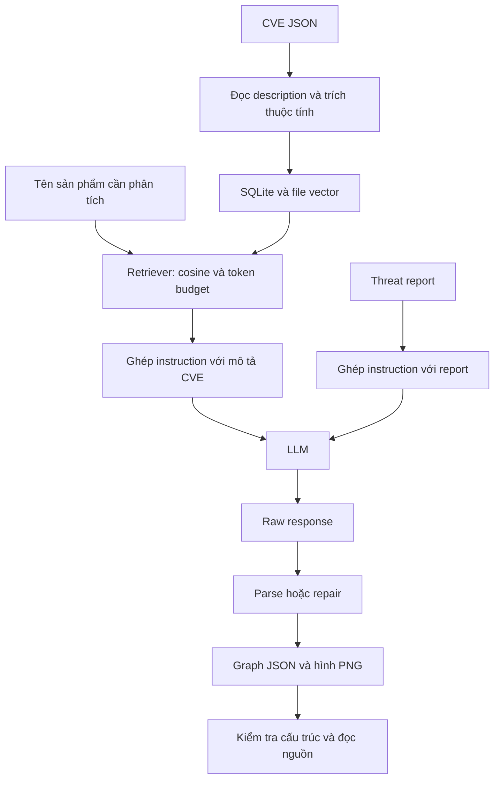

# Học và đọc code CrystalBall theo phạm vi vừa sức

**Runner ưu tiên hiện tại:** đọc thêm `paper_cases.py` (ánh xạ chín hình), `paper_runner.py` (ba model, freeze prompt, lưu response, resume), `paper_graph.py` (nút tròn và tên node/edge). Lệnh demo/thí nghiệm nằm trong [hướng dẫn chín hình](THI_NGHIEM_BA_MO_HINH.md); ví dụ runner full trong tài liệu này vẫn thuộc bộ lịch sử hai mô hình.

Tài liệu local, ngày 28/09/2026. Đi kèm [đánh giá phạm vi](DANH_GIA_REVIEW_VA_PHAM_VI.md). Mục tiêu là tự giải thích được pipeline, chạy từng phần và nhận ra giới hạn của graph sinh ra. Không cần thuộc toàn bộ repository.

**Cập nhật ngày 13/10/2026:** phạm vi hiện tại dùng ba mô hình độc lập: Gemini, GPT-5.6 Luna và DeepSeek. Các ví dụ/số liệu run `20260927_full_reproduction` bên dưới vẫn là kết quả hai mô hình. Đọc [hướng dẫn ba mô hình](THI_NGHIEM_BA_MO_HINH.md) để xem lệnh demo cùng đầu vào, thiết kế năm kịch bản/năm repeat và phần runner còn thiếu. Tên `openrouter_v2` chỉ là backend cho cấu hình OpenRouter thứ hai.

## 1. Bắt đầu ở đâu?

Học theo 6 buổi dưới đây, mỗi buổi khoảng 60–90 phút; nếu Python còn mới, dành thêm thời gian ở buổi 1. Chỉ chuyển bước khi làm được bài tự kiểm tra, không cần bám cứng thời lượng.

Trước tiên mở `src/crystalball/generator.py`: file này cho thấy sản phẩm hoặc report được biến thành prompt thế nào. Đừng bắt đầu bằng `scripts/run_paired_experiment.py`: file hơn 3.400 dòng chứa nhiều phần tổ chức thí nghiệm, ngân sách, journal và báo cáo. Các phần đó cần cho vận hành nhưng không phải điểm xuất phát tốt để hiểu ý tưởng chính.

Khi đọc một hàm, ghi ra đúng bốn điều: **đầu vào; đầu ra; dữ liệu thay đổi/lưu ở đâu; lỗi có thể xảy ra**. Khi gặp hàm được gọi, chỉ đọc phần đó trước, chưa cần đọc hết module.

## 2. Những kiến thức cần học

| Mảng | Cần hiểu tới mức nào? | Gặp trong code |
|---|---|---|
| Python | `dict`, `list`, `set`, vòng lặp, điều kiện, hàm và tham số mặc định | Hầu hết pipeline |
| Đọc/ghi dữ liệu | `Path`, UTF-8, JSON, `json.loads`, `read_text`, `write_text` | `preprocess.py`, `postprocess.py` |
| Cấu trúc chương trình | `import`, `if __name__ == '__main__'`, `argparse`, class, `dataclass`, `try/except` | Các script, `BuiltPrompt`, `AttackGraph` |
| CVE và điều kiện khai thác | Sản phẩm, phiên bản, platform, quyền có trước, tác động; phân biệt local/remote/physical access | CVE nguồn và prompt |
| Đồ thị có hướng | Node, edge, path; ID khác label; endpoint phải tồn tại | `postprocess.py`, `experiment.py` |
| SQLite | Bảng, dòng, khóa liên kết, `INSERT`, `SELECT`, tham số SQL | `db.py` |
| Vector và cosine | Text thành vector, dot product, norm; ngưỡng chọn kết quả | `embeddings.py`, `retriever.py` |
| RAG và LLM | Retrieval cung cấp tài liệu cho generation; prompt/context/response/token cap | `generator.py`, `llm/` |
| Kiểm thử và thực nghiệm | Test code khác chấm chất lượng; control, repeat, giới hạn lấy mẫu | `tests/`, báo cáo |

Chưa cần học huấn luyện Transformer, backpropagation, fine-tuning, toàn bộ PyTorch, Kubernetes chuyên sâu, viết exploit hoặc triển khai cloud. Dự án dùng embedding và LLM có sẵn; trọng tâm học là dòng dữ liệu và kiểm chứng đầu ra.

## 3. Bản đồ pipeline



Hai chỗ có thể gọi LLM: **extraction thuộc tính CVE** và **generation attack graph**. Retriever tự tính cosine; nó không hỏi LLM để quyết định từng kết quả. Threat report đi thẳng vào prompt, không phải qua retriever CVE.

| Bài báo | Điểm đọc code | Câu hỏi cần trả lời |
|---|---|---|
| Algorithm 1, trang 4 | `preprocess_cve()` trong `preprocess.py` | Description được đọc, trích thuộc tính và lưu thế nào? |
| §3.2, Algorithm 2 | `get_context()` trong `retriever.py` | Một CVE được chọn vì product hay platform nào? |
| Algorithm 3, trang 5 | `build_prompt_from_products()` và `call_llm_and_save()` trong `generator.py` | Phần nào tạo prompt, phần nào gọi model? |
| Đầu vào report, §3 | `build_prompt_from_report()` | Vì sao không cần CVE index? |
| §3.4 và thử repair §5.4 | `parse_llm_json()` trong `postprocess.py` | Raw khác graph đã parse ở đâu? |
| Chia/gộp §5.4 | `merge_graphs()` | Vì sao gộp xong chưa có path xuyên chunk? |

Repo lưu vector NumPy `.npy`, trong khi bài mô tả `.pt`. Đây là khác biệt lưu trữ; cần ghi nhận nhưng không làm thay đổi ý tưởng retrieval. Bản prototype chỉ retrieval theo product/platform; việc lưu problem type/version không có nghĩa code đã lọc theo chúng.

## 4. Buổi 1: Python, CVE và graph

Đọc một record dễ hiểu trước: `data/cve_official/CVE-2021-38759.json`. Tìm:

```text
cveMetadata.cveId
cveMetadata.state
containers.cna.descriptions
```

Đoạn Python sau chạy trong PowerShell tại thư mục repo, chỉ đọc dữ liệu:

```powershell
@'
import json
from pathlib import Path
p = Path('data/cve_official/CVE-2021-38759.json')
record = json.loads(p.read_text(encoding='utf-8'))
print(record['cveMetadata']['cveId'])
for item in record['containers']['cna']['descriptions']:
    if item['lang'].startswith('en'):
        print(item['value'])
'@ | .\.venv\Scripts\python.exe -
```

Ví dụ graph **minh họa để học JSON**, không phải output thực nghiệm:

```json
{
  "nodes": [
    {"id": "n1", "label": "Default password unchanged"},
    {"id": "n2", "label": "Administrator access"}
  ],
  "edges": [
    {"from": "n1", "to": "n2", "label": "Use default credentials under applicable conditions"}
  ]
}
```

`id` là định danh để cạnh tham chiếu; `label` là nội dung để đọc. `n1 → n2` thể hiện hướng quan hệ. Ở điều kiện CVE C1/C2, schema còn yêu cầu `precondition` và `postcondition` trong node; ví dụ tối giản trên chưa đáp ứng schema đó.

Tự kiểm tra: đổi `to` thành `n3` thì JSON vẫn đọc được nhưng endpoint sai vì không có node `n3`. Thêm node `n3` làm hết lỗi cấu trúc, vẫn chưa chứng minh quan hệ đó có thật.

## 5. Buổi 2: Đi từ CVE tới database và vector

Đọc theo thứ tự:

1. `scripts/ingest_cves.py`: `main()` nhận thư mục đầu vào và gọi tiền xử lý.
2. `src/crystalball/preprocess.py`: `_get_description()`, `preprocess_cve()`, `preprocess_directory()`.
3. `src/crystalball/extractors.py`: `ExtractedProperties`, `HeuristicExtractor.extract()`, sau đó `LLMExtractor.extract()`.
4. `src/crystalball/db.py`: bảng dữ liệu, `store_cve()`, `store_product()`, `store_platform()`.
5. `src/crystalball/embeddings.py`: `encode()`, `save_embedding()`, `load_embedding()`.

Lần theo một CVE bằng sơ đồ:

```text
file JSON
  → description tiếng Anh
  → ExtractedProperties(product_name, platform, versions, problem_type)
  → lưu description vào SQLite
  → encode từng thuộc tính cần vector
  → lưu vector vào file .npy
  → lưu đường dẫn vector cùng thuộc tính trong SQLite
```

Database chứa thông tin và đường dẫn; các vector nằm trong file riêng. `set` giúp bỏ trùng CVE ở bước retrieval, còn `clear_cve_properties()` giúp khi nạp lại một record không cộng dồn metadata cũ.

Hai extractor có vai trò khác nhau: heuristic đọc trường có cấu trúc và dùng quy tắc; LLM gửi description qua prompt để lấy thuộc tính. Hai embedding backend cũng khác nhau: hashing là cách biểu diễn từ đơn giản để học offline; Contriever là model dùng trong run chính. Thực hành hashing không tái tạo chất lượng retrieval của Contriever.

Tự kiểm tra: giải thích vì sao file `manifest.json` bị bỏ qua với `no description`, và vì sao record `REJECTED` không nên nạp như CVE hoạt động.

## 6. Buổi 3: Hiểu retriever

Đọc toàn bộ `get_context()` trong `src/crystalball/retriever.py`, rồi đọc `cosine_similarity()` trong `embeddings.py`.

Cosine là:

```text
cosine(a, b) = dot(a, b) / (norm(a) * norm(b))
```

Ví dụ `a=[1,0]`, `b=[1,0]` cho 1; `a=[1,0]`, `b=[0,1]` cho 0. Với embedding văn bản, điểm phản ánh độ giống nhau theo biểu diễn của model. Nó **không phải xác suất 68% một CVE khai thác được**.

Trong code:

1. Encode từng query term.
2. Đọc vector product; lấy điểm lớn nhất giữa product đó và các query term.
3. Nếu `best > min_similarity`, thêm CVE ID vào tập liên quan.
4. Lặp tương tự cho platform.
5. Lấy description theo các ID, ghép context cho tới token budget.

Lưu ý điều kiện là `>` chứ không phải `>=`. Một CVE có thể khớp nhiều product/platform nhưng chỉ cần đưa description một lần. `matches` là bằng chứng khớp trước khi ghép context; `relevant_cve_ids` trong kết quả là các CVE thật sự được đưa vào context sau budget. Vì thế hai danh sách không bắt buộc có số phần tử bằng nhau.

Code không xếp hạng top-k theo cosine; nó chọn qua ngưỡng rồi ghép description theo thứ tự truy vấn database. Nếu description tiếp theo làm vượt budget thì `break`. Đọc thêm `Database.get_cve_descriptions()` và `tokens.py` để hiểu thứ tự và cách ước lượng token.

Tự kiểm tra: vì sao Jetson không vào C1 chưa chắc là lỗi của model sinh graph? Vì generation chỉ nhận context đã chọn. Đừng hạ ngưỡng chỉ để ép kết quả trông giống bài báo.

## 7. Buổi 4: Tạo prompt và đọc response có sẵn

Đọc `generator.py` rồi `scripts/build_prompt.py`.

- `CVE_CONTEXT_PROMPT` yêu cầu schema và hướng dẫn chaining.
- `build_prompt_from_products(..., use_context=True)` gọi retrieval rồi ghép instruction với description.
- `use_context=False` dùng baseline riêng có tên sản phẩm.
- `build_prompt_from_report()` đọc văn bản và thêm instruction report.
- `call_llm_and_save()` gọi client và lưu raw; parse diễn ra ở bước riêng.

`BuiltPrompt.query` là metadata; không phải cứ query có target là target tự xuất hiện trong phần instruction gửi model. Hãy đọc chính `built.prompt`. Đặc điểm này giúp hiểu vì sao X0 lưu query trong manifest nhưng prompt thực tế vẫn thiếu target.

Ở buổi này chỉ cần đọc `llm/base.py` và `llm/factory.py` để hiểu interface `complete()` và cách chọn backend. Chưa cần đi sâu từng SDK.

### Thực hành offline đã kiểm tra trên máy này

Mở một terminal PowerShell mới, chạy trong repo. `.venv` hiện có đã chạy được 79 test. Nếu môi trường bị mất, xem phần cài đặt trong README; không cần cài model hoặc API extra cho bài thực hành này.

```powershell
Set-Location 'D:\AHUST\An ninh mạng\llm-attack-graph-generation'
$env:PYTHONIOENCODING = 'utf-8'
$env:LLM_BACKEND = 'manual'
$env:EXTRACTOR_BACKEND = 'heuristic'
$env:EMBEDDING_BACKEND = 'hashing'
$env:MIN_SIMILARITY = '0.68'
$env:CONTEXT_TOKENS_PER_QUERY = '3750'
$env:CRYSTALBALL_DB_PATH = "$PWD/outputs/study/data/study.sqlite3"
$env:CRYSTALBALL_EMBEDDINGS_DIR = "$PWD/outputs/study/embeddings"
$env:CRYSTALBALL_OUTPUTS_DIR = "$PWD/outputs/study/artifacts"

.\.venv\Scripts\python.exe scripts/ingest_cves.py --input data/cve_official
.\.venv\Scripts\python.exe scripts/build_prompt.py --products 'Oculus Desktop' 'Jetson TX1' 'Raspberry Pi'
```

Kết quả lần kiểm tra: nạp 8 CVE, bỏ qua manifest; heuristic/hashing lấy được 4 CVE và tạo prompt. Đây là kết quả học offline; không so trực tiếp với C1 lịch sử dùng LLM extraction/Contriever lấy 7 CVE. Lệnh tạo prompt chưa sinh graph vì `LLM_BACKEND=manual`.

Tiếp theo, dùng response **T0 và prompt T0 tương ứng** có sẵn để học hậu xử lý:

```powershell
.\.venv\Scripts\python.exe scripts/ingest_response.py `
  --response outputs/experiments/20260927_full_reproduction/raw_responses/graph.gemini.T0.r01.a01.txt `
  --prompt-file outputs/experiments/20260927_full_reproduction/prompts/T0.txt `
  --backend gemini `
  --model gemini-3.8-flash
```

Lệnh này không gọi Gemini: `--backend/--model` chỉ ghi nguồn của response được nhập. Kết quả đã kiểm tra: **10 node, 10 cạnh**, JSON/PNG mới dưới `outputs/study/artifacts/graphs/`. Đây là đọc lại output lịch sử, không phải một repeat mới và không phải graph sinh từ prompt hashing vừa tạo.

Mọi dữ liệu thực hành nằm dưới `outputs/study/`. Biến môi trường này chỉ áp dụng trong terminal đang dùng; mở terminal mới khi quay về cấu hình thí nghiệm chính. Các file Appendix đã chứa instruction; không đưa nguyên file đó qua `--report` để thêm instruction lần nữa.

## 8. Buổi 5: Parser, schema và ý nghĩa attack graph

Đọc `AttackGraph`, `parse_llm_json()`, `_attempt_repair()` trong `postprocess.py`; tiếp theo đọc `graph_schema_metrics()` trong `experiment.py`.

Parser có thể bỏ Markdown, nhận wrapper `attack_graph` và cố cứu phần JSON bị cắt. Repair chủ yếu giữ lại phần có thể đọc, không suy ra các node/edge đã mất. `AttackGraph.to_dict()` chỉ xuất nodes/edges; các cờ như truncation phải đọc ở metrics/metadata, không chỉ nhìn graph JSON.

Phân biệt bốn lớp:

| Lớp | Câu hỏi | Điều chưa chứng minh |
|---|---|---|
| Cú pháp | JSON gốc đọc được không? | Có đúng schema graph không? |
| Schema/cấu trúc | Đủ trường, ID và endpoint hợp lệ không? | Nội dung có đúng nguồn không? |
| Sự kiện | Có giữ đúng sự kiện và điều kiện từ nguồn không? | Các sự kiện nối thành chuỗi được không? |
| Quan hệ/path | Bước trước có cung cấp đủ điều kiện cho bước sau không? | Hệ thống triển khai thực tế có thỏa giả định không? |

Ví dụ khi đọc cạnh `piSignage → RaspAP`: nguồn nói một bên tải file trái phép, bên kia cần authenticated access để chạy command. Muốn nối, phải có bằng chứng hoặc giả định rõ rằng file lấy được chứa thông tin xác thực dùng được, đúng môi trường và có khả năng truy cập dịch vụ. “Có hai CVE trên Raspberry Pi” chưa đủ.

Các CVE cũng không bắt buộc phải nối hết. Một node đứng riêng có thể phản ánh nguồn không cung cấp bridge. Không nên tự thêm cạnh để graph liền mạch hơn.

Mẫu ghi chú cho ba cạnh bạn tự đọc:

| Cạnh | Bằng chứng nguồn | Điều kiện còn thiếu | Kết luận |
|---|---|---|---|
| Điền ID/label | Ghi câu hoặc vị trí trong prompt | Host, version, quyền, credential, physical access… | Hỗ trợ / có điều kiện / không hỗ trợ / chưa rõ |

Chọn một quan hệ default password → admin, một bridge Browser → OVRRedir và một quan hệ liên quan Glowworm. Nếu một output không chứa cạnh cần tìm, ghi đúng là không có; không tự vẽ thêm.

## 9. Buổi 6: Test, kết quả thí nghiệm và cách trình bày

Chạy:

```powershell
.\.venv\Scripts\python.exe -m pytest -q
.\.venv\Scripts\python.exe -m pytest tests/test_retriever.py tests/test_postprocess.py -q
```

Đọc ba test có ý nghĩa cụ thể: retrieval bỏ sản phẩm không liên quan, context tuân thủ budget, parser nhận wrapper `attack_graph`. Xác định input giả lập, hàm được gọi và điều kiện `assert`. Test dùng dữ liệu nhỏ để kiểm tra hành vi code; không chứng minh model sinh graph đúng về an ninh mạng.

Sau đó đọc `REPRODUCTION_REPORT.md`, rồi mới tìm các hàm sau trong runner:

- `build_conditions()` để hiểu C0/C1/C2/T0/T1/T2/X0.
- `response_graph_metrics()` và `classify_parse_mode()` để hiểu số liệu.
- `section54_prompts()` để hiểu chia, tiếp tục và mở rộng.
- `write_reproduction_artifacts()` để thấy nơi tổng hợp báo cáo và lỗi kết luận cũ được chỉ ra trong tài liệu đánh giá.

Chưa cần chạy full runner. Bộ tạo báo cáo còn khả năng ghi đè báo cáo đã sửa bằng kết luận cũ; luồng học phía trên không đi qua nó.

Tóm tắt điều kiện cần nhớ: C0 baseline không context; C1 retrieval; C2 đủ tám mô tả Appendix A; T0 hai nhánh Appendix B; T1 toàn SolarWinds; T2 phần evasion; X0 thiếu cả context và target. Run lịch sử lặp mỗi tổ hợp chính 5 lần với hai mô hình thay thế. Thiết kế tiếp theo dùng C0/C2/T0/T1/T2 × ba mô hình × năm repeat; runner hiện cần mở rộng trước khi thực hiện thiết kế đó.

Khi trình bày, dùng 5 phút để trả lời: vấn đề là gì; hai loại đầu vào; ba thuật toán; một graph cụ thể; một cạnh cần thận trọng; giới hạn kết luận. Bạn không cần đưa toàn bộ 130 response lên slide.

## 10. Khi nào coi là đã hiểu đủ?

Bạn đã đạt mục tiêu học ban đầu khi có thể:

- Vẽ lại pipeline và chỉ đúng file/hàm của từng bước.
- Theo một CVE từ JSON tới metadata, vector và context.
- Giải thích cosine, ngưỡng 0,68 và token budget mà không gọi chúng là accuracy.
- Phân biệt prompt, raw response, graph JSON và metrics.
- Tự chạy luồng offline, biết nó khác run chính ở extractor/embedding.
- Giải thích vì sao parse/repair/schema pass không chứng minh attack path đúng.
- Đọc nguồn để đánh giá ba cạnh, giữ lại điều kiện chưa được xác nhận.
- Nêu được điều dự án đã làm và điều chưa thể kết luận.

Nếu chưa đạt một mục, quay lại đúng buổi liên quan. Chưa cần thêm tính năng để bù cho chỗ chưa hiểu.

## 11. Câu hỏi tự kiểm tra và đáp án ngắn

1. **Product/platform dùng để làm gì?** Tìm CVE liên quan; description mới là nội dung chính được đưa vào context.
2. **CVE không vào graph thì lỗi ở đâu?** Kiểm tra lần lượt nguồn → extraction → retrieval → budget → prompt → response → parser; chưa thể quy ngay cho LLM.
3. **Một CVE khớp cả product lẫn platform có đưa hai lần không?** Tập ID loại trùng trước khi ghép description.
4. **Graph nhiều node hơn có tốt hơn không?** Chưa biết; có thể chi tiết hơn, lặp lại hoặc thêm thông tin thiếu căn cứ.
5. **Cạnh A→B có ý nghĩa gì?** Graph khẳng định hoặc giả định một quan hệ có hướng; phải kiểm tra điều kiện để phân biệt chuỗi khai thác, điều kiện đầu vào và phân nhánh mô tả.
6. **Hai cạnh cùng vào một node có tự biểu diễn AND không?** Không. Đồ thị có hướng thông thường không tự quy định ngữ nghĩa AND/OR.
7. **Merge có tự suy ra cạnh xuyên chunk không?** Không; code hợp node/edge và xử lý ID trùng, không chứng minh quan hệ mới.
8. **Có cần tái tạo nguyên hình paper không?** Không đối với mục tiêu học phương pháp với model thay thế; cần so thông tin, điều kiện và quan hệ, không so vị trí node trên hình.
9. **79 test pass cho biết gì?** Các hành vi mà test kiểm tra đang qua; không đo chất lượng ngữ nghĩa của output model.
10. **Bước tiếp theo phù hợp nhất?** Tự giải thích `build_prompt_from_products()`, rồi lần ngược vào `get_context()` và `preprocess_cve()`.
