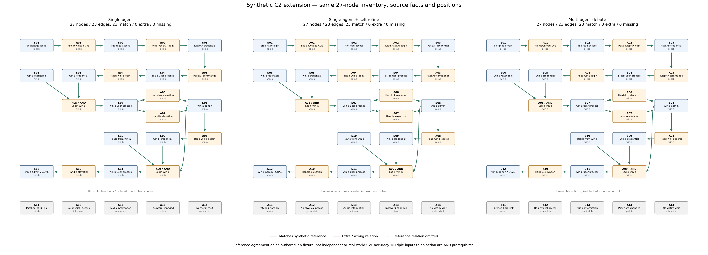

# C2 mở rộng: 27 node trạng thái/hành động

Dữ liệu lab mô phỏng, cùng inventory và graph nháp cho ba nhánh. Tham chiếu 23 quan hệ định nghĩa trước, không gửi cho model. Đây là mức khớp tham chiếu mô phỏng; không phải accuracy trên hệ thống thật.

| Round | Nhánh | Node | Cạnh | Khớp / Thừa / Thiếu | Precision tham chiếu | Recall tham chiếu | F1 tham chiếu | Tokens gồm reasoning |
|---|---|---:|---:|---|---:|---:|---:|---:|
| 1 | grounded | 27 | 23 | 23 / 0 / 0 | 100.0% | 100.0% | 100.0% | 14836 |
| 1 | self_refine | 27 | 23 | 23 / 0 / 0 | 100.0% | 100.0% | 100.0% | 79231 |
| 1 | debate | 27 | 23 | 23 / 0 / 0 | 100.0% | 100.0% | 100.0% | 75130 |

Lượt hiện tại: 7 request riêng biệt, tổng 139525 token theo provider.
Draft dùng chung tính vào mỗi nhánh để so sánh nhưng chỉ thực hiện một lần. Output text không gồm toàn bộ reasoning; total_tokens theo provider có tính reasoning.

Các lượt trước được giữ riêng: một draft JSON lỗi (12.130 token), một request bị ngắt chưa có response/usage. Không coi chúng là kết quả hợp lệ; tổng chi phí cả lịch sử chưa đầy đủ.

Đây là bản phục hồi định dạng sau khi strict parser dừng ở Markdown fence của Defender. Đã dùng lại 5 request; không gửi lại chúng. Chỉ chấp nhận một lớp Markdown bao trọn JSON ở mọi stage; nội dung, duplicate-key/schema, quote và decision checks giữ nguyên. Kết quả không được coi là pass giao thức strict ban đầu.
Các stage đã bóc Markdown: runs\r01\format_normalization\debate.r1.defender.audit.json

## grounded

Trạng thái: `ready_for_independent_validation`.

- Cạnh thêm so với draft: `[]`
- Cạnh bỏ so với draft: `[]`
- Quan hệ thừa/sai: `[]`
- Quan hệ thiếu: `[]`
- Đủ hai nhóm AND: `{'A05': True, 'A09': True}`
- Cạnh liên quan đối chứng âm: 0
- Thời gian API gồm draft: 55.8 giây

## self_refine

Trạng thái: `ready_for_independent_validation`.

- Cạnh thêm so với draft: `[]`
- Cạnh bỏ so với draft: `[]`
- Quan hệ thừa/sai: `[]`
- Quan hệ thiếu: `[]`
- Đủ hai nhóm AND: `{'A05': True, 'A09': True}`
- Cạnh liên quan đối chứng âm: 0
- Thời gian API gồm draft: 196.2 giây

## debate

Trạng thái: `ready_for_independent_validation`.

- Cạnh thêm so với draft: `[]`
- Cạnh bỏ so với draft: `[]`
- Quan hệ thừa/sai: `[]`
- Quan hệ thiếu: `[]`
- Đủ hai nhóm AND: `{'A05': True, 'A09': True}`
- Cạnh liên quan đối chứng âm: 0
- Thời gian API gồm draft: 150.6 giây

Node đã được cho sẵn để cố định độ hạt; thí nghiệm đo dựng quan hệ, không đo khả năng tự khám phá node. Label, điều kiện, bridge và bằng chứng vẫn cần người đọc kiểm tra. Chỉ một repeat: chưa đo độ ổn định hoặc chứng minh lợi ích tổng quát của debate.
Ảnh dùng cùng tên ngắn và vị trí node từ fixture để thấy khác biệt về cạnh. Label/pre/postcondition nguyên bản model sinh vẫn nằm trong candidate.json/graph.json của từng nhánh.
