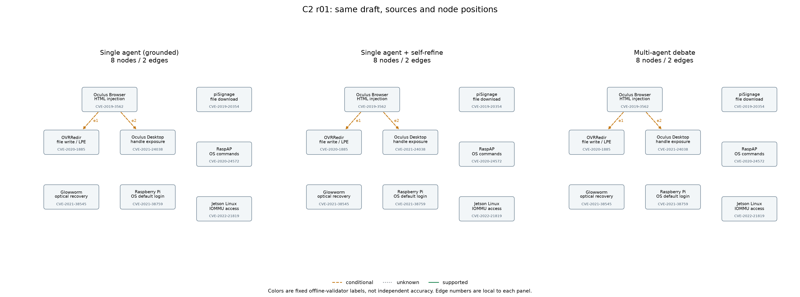

# So sánh C2 theo cặp

Cùng graph nháp; cùng tám CVE; cùng model cho các vai trò: True.

Nhãn bên dưới là validator offline. Chưa có gold độc lập; accuracy = N/A.

| Round | Nhánh | Trạng thái | Node | Cạnh | Thêm / bỏ so với draft | Nhãn offline | Calls gồm draft |
|---|---|---|---:|---:|---|---|---:|
| r01 | grounded | ready_for_independent_validation | 8 | 2 | 0 / 0 | {'conditional': 2} | 1 |
| r01 | self_refine | ready_for_independent_validation | 8 | 2 | 0 / 0 | {'conditional': 2} | 4 |
| r01 | debate | ready_for_independent_validation | 8 | 2 | 0 / 0 | {'conditional': 2} | 4 |

Tổng số request riêng biệt: **7**. Usage: `{"input_tokens": 16897, "output_tokens": 5554, "total_tokens": 46291, "requests_with_usage": 7, "requests_missing_usage": 0, "totals_are_partial": false, "gemini_thoughts_tokens": 23840, "note": "Gemini output_tokens here counts text candidates; provider total_tokens includes thoughts."}`.
Draft chung được tính vào từng nhánh khi so sánh, nhưng chỉ gọi/bị tính phí một lần.

## r01

### CVE-2019-3562 → CVE-2020-1885

- **grounded:** Potential code execution provides local access to exploit file write
  - Bridge: Potential code execution achieved via the Oculus Browser vulnerability could establish an unprivileged local user execution context on Windows, enabling the attacker to act as a local user and exploit the hard-link log file write vulnerability in Oculus Desktop.
  - Điều kiện chưa quan sát: Oculus Browser is operating on the same Windows host where Oculus Desktop is installed.; Code execution is successfully achieved from the browser sandbox and yields an interactive or usable local user context.
- **self_refine:** Potential code execution provides local access to exploit file write
  - Bridge: Potential code execution achieved via the Oculus Browser vulnerability could establish an unprivileged local user execution context on Windows, enabling the attacker to act as a local user and exploit the hard-link log file write vulnerability in Oculus Desktop.
  - Điều kiện chưa quan sát: Oculus Browser is operating on the same Windows host where Oculus Desktop is installed.; Code execution is successfully achieved from the browser sandbox and yields an interactive or usable local user context.
- **debate:** Potential code execution provides local user execution context to exploit hard-link file write
  - Bridge: Potential code execution achieved through the Oculus Browser vulnerability could establish an unprivileged local user execution context, enabling the attacker to act as a local user on Windows and exploit the hard link vulnerability in Oculus Desktop.
  - Điều kiện chưa quan sát: Oculus Browser executes on the same Windows host where Oculus Desktop is installed.; Potential code execution successfully breaks out or operates in a context that permits local file operations and hard link creation.

### CVE-2019-3562 → CVE-2021-24038

- **grounded:** Potential code execution provides unprivileged process to obtain privileged handle
  - Bridge: Potential code execution via the Oculus Browser vulnerability may spawn or control an unprivileged process on the host, fulfilling the prerequisite of having an unprivileged process available to receive the exposed privileged handle from OVRServiceLauncher.exe.
  - Điều kiện chưa quan sát: Oculus Browser executes on the same system running OVRServiceLauncher.exe.; The potential code execution successfully produces a running unprivileged process capable of interacting with system handles.
- **self_refine:** Potential code execution provides unprivileged process to obtain privileged handle
  - Bridge: Potential code execution via the Oculus Browser vulnerability may spawn or control an unprivileged process on the host, fulfilling the prerequisite of having an unprivileged process available to receive the exposed privileged handle from OVRServiceLauncher.exe.
  - Điều kiện chưa quan sát: Oculus Browser executes on the same system running OVRServiceLauncher.exe.; The potential code execution successfully produces a running unprivileged process capable of interacting with system handles.
- **debate:** Potential code execution creates an unprivileged process capable of receiving exposed privileged handle
  - Bridge: Potential code execution through Oculus Browser may instantiate an unprivileged local process on the host, fulfilling the prerequisite of having an unprivileged process present to receive the exposed privileged handle from OVRServiceLauncher.exe.
  - Điều kiện chưa quan sát: Oculus Browser is co-deployed on the same system running OVRServiceLauncher.exe.; The code execution results in a running unprivileged process capable of receiving or interacting with Windows process handles.

