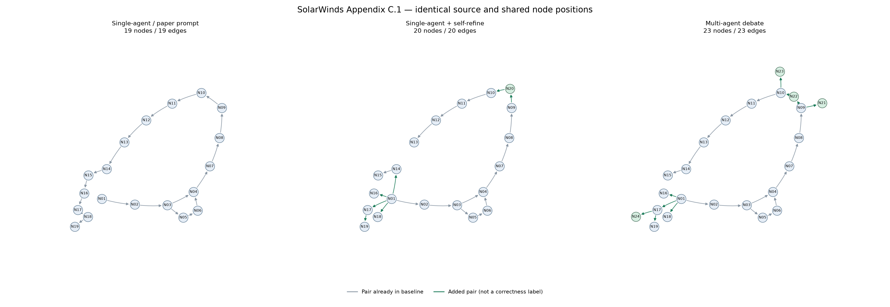

# SolarWinds: prompt bài gốc + multi-agent debate

Case T1, Figure 2. Baseline nhận đúng bytes prompt đã trích và chuẩn hóa từ bài gốc.
Không bổ sung data mô phỏng, node inventory hoặc ép số lượng cạnh. Model hiện tại khác GPT-4 trong bài; không kỳ vọng ảnh giống từng node/cạnh.

| Round | Cách sinh | Trạng thái | Node | Cạnh | Node thêm/bỏ | Cặp cạnh thêm/bỏ | Token provider |
|---|---|---|---:|---:|---|---|---:|
| 1 | single | completed | 19 | 19 | 0/0 | 0/0 | 7324 |
| 1 | self_refine | completed | 20 | 20 | 1/0 | 7/6 | 74152 |
| 1 | debate | completed | 23 | 23 | 4/0 | 9/5 | 65171 |

Tổng request riêng biệt: **7**. Tổng token theo provider: **131999**.
Các nhánh dùng chung draft. Bảng tính draft vào mỗi nhánh để so sánh, API chỉ thực hiện draft một lần. Tự sửa và debate cùng bốn calls/cap nhưng khác input length/actual usage.

**Chưa có gold độc lập: accuracy/precision/recall/F1 = N/A.** Số cạnh tăng, trích dẫn đúng hoặc reviewer đồng ý không chứng minh graph đúng hơn.

## Round 1



### Single-agent / paper prompt

Thay đổi dựa trên ID/pair (cần người đối chiếu nếu tách/gộp/đổi tên node):

```json
{
  "added_node_ids": [],
  "removed_node_ids": [],
  "changed_nodes": [],
  "added_pairs": [],
  "removed_pairs": [],
  "changed_retained_pairs": [],
  "id_based_alignment_only": true,
  "warning": "Renamed/split/merged concepts need human alignment; pair changes are not semantic errors."
}
```


[Ảnh nhãn đầy đủ kiểu paper](paper_style/r01_single/graph.png) · [Bản xem tương tác](paper_style/r01_single/graph.html)

### Single-agent + self-refine

Thay đổi dựa trên ID/pair (cần người đối chiếu nếu tách/gộp/đổi tên node):

```json
{
  "added_node_ids": [
    "api_connectivity_check"
  ],
  "removed_node_ids": [],
  "changed_nodes": [],
  "added_pairs": [
    [
      "anti_analysis_defense_evasion",
      "api_connectivity_check"
    ],
    [
      "api_connectivity_check",
      "dga_resolution"
    ],
    [
      "credential_abuse",
      "data_theft_impact"
    ],
    [
      "unc2452_actor",
      "c2_infrastructure_masquerading"
    ],
    [
      "unc2452_actor",
      "credential_abuse"
    ],
    [
      "unc2452_actor",
      "teardrop_dropper"
    ],
    [
      "unc2452_actor",
      "temporary_file_task_mod"
    ]
  ],
  "removed_pairs": [
    [
      "anti_analysis_defense_evasion",
      "dga_resolution"
    ],
    [
      "c2_infrastructure_masquerading",
      "credential_abuse"
    ],
    [
      "cobalt_strike_beacon",
      "c2_infrastructure_masquerading"
    ],
    [
      "credential_abuse",
      "temporary_file_task_mod"
    ],
    [
      "steganography_jobs",
      "teardrop_dropper"
    ],
    [
      "temporary_file_task_mod",
      "data_theft_impact"
    ]
  ],
  "changed_retained_pairs": [
    [
      "teardrop_dropper",
      "cobalt_strike_beacon"
    ],
    [
      "unc2452_actor",
      "solarwinds_supply_chain"
    ]
  ],
  "id_based_alignment_only": true,
  "warning": "Renamed/split/merged concepts need human alignment; pair changes are not semantic errors."
}
```

Sidecar bên dưới là lượt tự sửa cuối; [lịch sử đủ ba lượt](r01_self_refine_history.json) giữ các sửa đổi trước đó. Diff phía trên luôn so graph cuối với baseline.

- **add node `api_connectivity_check`:** The report specifies that before DGA domain generation begins, the malware explicitly verifies network connectivity by attempting to resolve api.solarwinds.com once blocklists pass.
  - P044 (verified_text_only): If all blocklist tests pass, the sample tries to resolve api.solarwinds.com to test the network for connectivity.
- **remove edge `edge-0010`:** Removes the direct edge from anti_analysis_defense_evasion to dga_resolution, as the connectivity check against api.solarwinds.com must succeed before DGA generation commences.
  - P046 (verified_text_only): If all blocklist and connectivity checks pass, the sample starts generating domains in a while loop via its DGA.
- **add edge `anti_analysis_defense_evasion->api_connectivity_check`:** Captures the prerequisite check where the backdoor resolves api.solarwinds.com once all process, service, and driver blocklist tests pass.
  - P044 (verified_text_only): If all blocklist tests pass, the sample tries to resolve api.solarwinds.com to test the network for connectivity.
- **add edge `api_connectivity_check->dga_resolution`:** Captures that DGA domain generation in a while loop is entered only after both blocklist and connectivity checks succeed.
  - P046 (verified_text_only): If all blocklist and connectivity checks pass, the sample starts generating domains in a while loop via its DGA.

[Ảnh nhãn đầy đủ kiểu paper](paper_style/r01_self_refine/graph.png) · [Bản xem tương tác](paper_style/r01_self_refine/graph.html)

### Multi-agent debate

Thay đổi dựa trên ID/pair (cần người đối chiếu nếu tách/gộp/đổi tên node):

```json
{
  "added_node_ids": [
    "ip_blocklist_termination",
    "network_connectivity_check",
    "recon_storage_in_plugin_config",
    "tool_and_backdoor_removal"
  ],
  "removed_node_ids": [],
  "changed_nodes": [],
  "added_pairs": [
    [
      "anti_analysis_defense_evasion",
      "network_connectivity_check"
    ],
    [
      "anti_analysis_defense_evasion",
      "recon_storage_in_plugin_config"
    ],
    [
      "credential_abuse",
      "data_theft_impact"
    ],
    [
      "credential_abuse",
      "tool_and_backdoor_removal"
    ],
    [
      "dga_resolution",
      "ip_blocklist_termination"
    ],
    [
      "network_connectivity_check",
      "dga_resolution"
    ],
    [
      "unc2452_actor",
      "c2_infrastructure_masquerading"
    ],
    [
      "unc2452_actor",
      "credential_abuse"
    ],
    [
      "unc2452_actor",
      "temporary_file_task_mod"
    ]
  ],
  "removed_pairs": [
    [
      "anti_analysis_defense_evasion",
      "dga_resolution"
    ],
    [
      "c2_infrastructure_masquerading",
      "credential_abuse"
    ],
    [
      "cobalt_strike_beacon",
      "c2_infrastructure_masquerading"
    ],
    [
      "credential_abuse",
      "temporary_file_task_mod"
    ],
    [
      "temporary_file_task_mod",
      "data_theft_impact"
    ]
  ],
  "changed_retained_pairs": [
    [
      "c2_domain_cname",
      "http_c2_communication"
    ],
    [
      "dga_resolution",
      "c2_domain_cname"
    ],
    [
      "initial_dormant_period",
      "anti_analysis_defense_evasion"
    ],
    [
      "steganography_jobs",
      "teardrop_dropper"
    ],
    [
      "teardrop_dropper",
      "cobalt_strike_beacon"
    ],
    [
      "unc2452_actor",
      "solarwinds_supply_chain"
    ]
  ],
  "id_based_alignment_only": true,
  "warning": "Renamed/split/merged concepts need human alignment; pair changes are not semantic errors."
}
```

- **revise edge `edge-0001`:** The report specifies that the actors trojanized Orion business software updates rather than describing source code repository injection.
  - P002 (verified_text_only): FireEye discovered a supply chain attack trojanizing SolarWinds Orion business software updates in order to distribute malware we call SUNBURST.
- **revise edge `edge-0009`:** Execution only proceeds to process/service discovery if the ReportWatcherRetry key is valid and domain membership is validated.
  - P042 (verified_text_only): The key ReportWatcherRetry must be any value other than 3 for the sample to continue execution. The sample checks that the machine is domain joined and retrieves the domain name before execution continues.
- **add node `recon_storage_in_plugin_config`:** Captures the backdoor's defense evasion technique of storing reconnaissance and stopped services into legitimate plugin config files.
  - P006 (verified_text_only): stores reconnaissance results within legitimate plugin configuration files allowing it to blend in with legitimate SolarWinds activity.
  - P044 (verified_text_only): The list of stopped services is then bit-packed into the ReportWatcherPostpone key of the appSettings entry for the samples' config file.
- **add edge `anti_analysis_defense_evasion->recon_storage_in_plugin_config`:** Identifies that stopped service findings are written directly into the ReportWatcherPostpone config field.
  - P044 (verified_text_only): The list of stopped services is then bit-packed into the ReportWatcherPostpone key of the appSettings entry for the samples' config file.
- **add node `network_connectivity_check`:** The sample explicitly tests network connectivity before domain generation begins.
  - P044 (verified_text_only): If all blocklist tests pass, the sample tries to resolve api.solarwinds.com to test the network for connectivity.
- **revise edge `edge-0010`:** Passing anti-analysis blocklists directly transitions to the connectivity check rather than straight to DGA domain generation.
  - P044 (verified_text_only): If all blocklist tests pass, the sample tries to resolve api.solarwinds.com to test the network for connectivity.
- **add edge `network_connectivity_check->dga_resolution`:** DGA generation loop only initiates once both blocklists and network connectivity checks succeed.
  - P046 (verified_text_only): If all blocklist and connectivity checks pass, the sample starts generating domains in a while loop via its DGA.
- **add node `ip_blocklist_termination`:** Hardcoded IP blocklist hits cause malware termination and persistent execution disabling.
  - P046 (verified_text_only): Records within the following ranges will terminate the malware and update the configuration key ReportWatcherRetry to a value that prevents further execution:
- **add edge `dga_resolution->ip_blocklist_termination`:** DNS A-record resolution branches to termination if the resolved IP falls within blocklisted ranges.
  - P046 (verified_text_only): The DNS A record of generated domains is checked against a hardcoded list of IP address blocks which control the malware's behavior. Records within the following ranges will terminate the malware and update the configuration key ReportWatcherRetry
- **revise edge `edge-0011`:** Clarifies that CNAME DNS retrieval directly leads to C2 domain assignment and HTTP helper spawning.
  - P046 (verified_text_only): Once a domain has been successfully retrieved in a CNAME DNS response the sample will spawn a new thread of execution invoking the method HttpHelper.Initialize which is responsible for all C2 communications and dispatching.
- **revise edge `edge-0014`:** TEARDROP was observed in 'at least one instance' among multiple different payloads, not as an inevitable universal next step.
  - P012 (verified_text_only): Multiple SUNBURST samples have been recovered, delivering different payloads. In at least one instance the attackers deployed a previously unseen memory-only dropper we've dubbed TEARDROP to deploy Cobalt Strike BEACON.
- **revise edge `edge-0015`:** Preserves the environmental check and the report's qualified assessment ('believe') that TEARDROP loaded customized Cobalt Strike BEACON.
  - P012 (verified_text_only): Next it checks that HKU SOFTWARE Microsoft CTF exists, decodes an embedded payload using a custom rolling XOR algorithm and manually loads into memory an embedded payload using a custom PE-like file format.
  - P012 (verified_text_only): We believe that this was used to execute a customized Cobalt Strike BEACON.
- **remove edge `edge-0016`:** C2 infrastructure masquerading is an actor-level evasion practice, not a direct causal output of Cobalt Strike BEACON execution.
  - P018 (verified_text_only): The actor sets the hostnames on their command and control infrastructure to match a legitimate hostname found within the victim's environment.
  - P024 (verified_text_only): The attacker primarily used only IP addresses originating from the same country as the victim, leveraging Virtual Private Servers.
- **add edge `unc2452_actor->c2_infrastructure_masquerading`:** Roots C2 infrastructure configuration and masquerading directly with the threat actor.
  - P018 (verified_text_only): The actor sets the hostnames on their command and control infrastructure to match a legitimate hostname found within the victim's environment.
- **remove edge `edge-0017`:** Credential abuse is an overarching actor preference for access, not a downstream effect of C2 hostname masquerading.
  - P010 (verified_text_only): This actor prefers to maintain a light malware footprint, instead preferring legitimate credentials and remote access for access into a victim's environment.
- **add edge `unc2452_actor->credential_abuse`:** Directly links threat actor UNC2452 to credential abuse and distinct credential usage for lateral movement.
  - P010 (verified_text_only): This actor prefers to maintain a light malware footprint, instead preferring legitimate credentials and remote access for access into a victim's environment.
  - P028 (verified_text_only): Once the attacker gained access to the network with compromised credentials, they moved laterally using multiple different credentials.
- **remove edge `edge-0018`:** Temporary file replacement and task modification are execution evasion techniques employed by the actor, not downstream products of credential abuse.
  - P032 (verified_text_only): The attacker used a temporary file replacement technique to remotely execute utilities: they replaced a legitimate utility with theirs, executed their payload, and then restored the legitimate original file.
- **add edge `unc2452_actor->temporary_file_task_mod`:** Directly links UNC2452 to remote execution via temporary file replacement and scheduled task modification.
  - P032 (verified_text_only): The attacker used a temporary file replacement technique to remotely execute utilities: they replaced a legitimate utility with theirs, executed their payload, and then restored the legitimate original file.
- **add node `tool_and_backdoor_removal`:** Captures the attacker's defining operational security habit of cleaning up backdoors once legitimate remote access was obtained.
  - P032 (verified_text_only): They routinely removed their tools, including removing backdoors once legitimate remote access was achieved.
- **add edge `credential_abuse->tool_and_backdoor_removal`:** Achieving legitimate remote access directly triggered routine removal of backdoors and tools.
  - P032 (verified_text_only): They routinely removed their tools, including removing backdoors once legitimate remote access was achieved.
- **revise edge `edge-0019`:** Reroutes impact from credential-enabled network access and lateral movement directly to data theft and lateral movement.
  - P004 (verified_text_only): Post compromise activity following this supply chain compromise has included lateral movement and data theft.
  - P028 (verified_text_only): Once the attacker gained access to the network with compromised credentials, they moved laterally using multiple different credentials.

Audit trích dẫn của hai reviewer: `{"defender": {"markdown_fence_removed": true, "verified_citations": 20, "unverified_citations": 1}, "skeptic": {"markdown_fence_removed": true, "verified_citations": 16, "unverified_citations": 0}}`.
Đây là selective review tối đa 12 findings + 6 omissions mỗi bên; không phải audit toàn bộ graph.

[Ảnh nhãn đầy đủ kiểu paper](paper_style/r01_debate/graph.png) · [Bản xem tương tác](paper_style/r01_debate/graph.html)

## Cách đọc

Màu xanh lá biểu thị pair/node thêm so với baseline, không phải nhãn đúng. Ảnh giữ chung vị trí và mã node; tên đầy đủ trong node_legend.csv và index.html.
So sánh Figure 2 trong paper_references để tham khảo mức trừu tượng của bài; không dùng toàn bộ hình như nhãn chuẩn đầy đủ.
Chấm cạnh bằng nguồn: supported/conditional/unknown/unsupported/contradicted, giữ uncertainty/alternative/scope. Đây là khung chấm cho người đọc, không chạy validator tám CVE.
annotation_source_blind.json dành cho chuẩn coverage trước khi nhìn graph; runs/rNN/<strategy>/annotation_blind.json dành cho cạnh. Các ô nhãn đều để trống.
